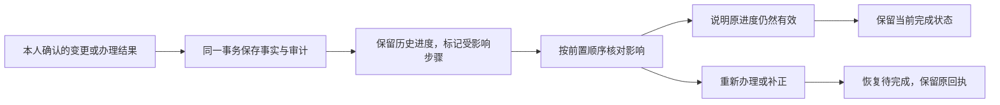

# ADR-002：变更后的办理影响复核

状态：已在 1.6.0 采用。日期：2026-10-18。

## 问题

原 MVP 要求保留个人完成、备注和计划，完整版同时要求更正能传递到后续行动。只保留 `done` 会让已经失效的旧办理成为后续提交的有效前提；直接把所有完成项改回待办则会抹掉用户的实际进度。正式期限撤回时，旧提醒也不能反过来阻止真实变更落库。

实际回归先复现两个缺陷：已完成的前置步骤新增材料后仍可被后续提交复用；正式日期改为待定但保留旧提醒时，应用变更返回 422。检查依赖链时还发现删除前置通知、已完成后收到补件／退回结果，也需要传播影响。

## 决策

在现有事务内增加独立的 `task_reviews`，以 `action_review_schema_version=1` 增量创建。个人任务状态、办理进度和影响复核各自表达不同事实：

| 记录 | 表达什么 | 变化规则 |
|---|---|---|
| `tasks.status` | 本人标记的行动完成／取消 | 不因新要求自动重写历史完成 |
| `task_workflows` | 准备、提交、回执、结果、下一步与依赖 | 只记录本人提供的进度，不充当学校系统回执 |
| `task_reviews` | 这些旧进度在新条件下是否仍有效 | 待复核 → 本人说明依据后保留进度或重新办理 |

正式要求变化时，已完成或已有提交／受理／退回记录的本步骤进入复核。日期变化且已有个人计划／提醒时，同样要求检查安排。尚未开始、没有个人安排的简单改期不用重复确认一次相同事实。

取消、恢复、重新打开、删除以及材料、提交方式、地点等实质变化，沿同账号前置图传到所有后续步骤。已完成之后新收到补件、受阻或退回结果，或者已办理事项的前置关系发生变化，也进入同一复核流程。私人的普通备注编辑不触发全链复核。

同一来源多次变更合并为一项待核对来源，累计尚未复核的字段，保留最新来源版本；每次变化仍分别写审计记录。删除前置通知时在原依赖图删除前传播，新的复核说明使用“已删除的前置事项”，不在新提示中复制已删原文。

### 确认与约束

- 复核需要任务版本、复核版本和至少两字的本人依据；不预选结论。新变化使旧复核表单和草稿失效，跨账号请求拒绝。
- 后续步骤先处理前置的待复核状态。复核完毕仍不等于前置已完成，实际提交／受理／完成继续检查前置任务状态。
- 选择保留只说明本人认为原进度仍适用；选择重新办理将完成项改回待完成，有原回执时进入待补件，否则进入准备中。原回执、备注和前后记录保留。
- 取消项不能通过复核绕过正式恢复流程。完成项不会被系统伪造为学校已受理。
- 提交、完成和新提醒导出不可跳过待复核状态；查看、记录准备和处理个人计划继续可用。
- 重复发送同一次成功复核不会重复改状态。异步界面按弹窗代次和页面版本处理结果，迟到保存不能关闭新表单。

### 日期与提醒

正式变更先保存核实后的事实，保留个人提醒供本人处理。日期变成待定时，若没有个人计划，原提醒进入需要调整状态；明确新期限早于旧提醒时也阻止复核结束。用户可清除提醒，或建立本人核实信息的计划和提醒。

日期只有“某日”时按日期比较，不补造 23:59；含时刻时按北京时间比较，支持输入时区换算。个人计划晚于正式期限会提示，但计划本身不是正式期限。当前导出仍是 ICS 快照，程序没有远程删除手机旧事件的能力。

### AI、备份与迁移

获准使用日程的回答取得办理记录和复核状态，并明确历史完成可能已经失效、回执是本人记录。尚未确认的变更只提供状态标记，不冒充已生效的要求。上下文指纹包含任务、办理、复核和待确认变更版本；生成中发生这些变化不能让旧回答落为成功。未获准读取日程的回答不取得这些记录。

SQLite 备份保留全部状态及版本，未知未来结构拒绝开启和恢复。JSON 追加导入保留待复核状态、结论、说明和来源关系；按当前账号重新绑定来源，同次和分批导入均可补齐。无法找到来源时显示缺失；不指向其他账号。导入提醒仍清空，期限仍须重新核实。没有历史复核记录的旧数据不会凭空生成已核验结论。

删除通知会级联删除该通知的任务及复核记录；其他通知仍保留自身的依赖缺失提示和已有办理审计。完整历史恢复仍使用 SQLite 备份，JSON 不是完整审计镜像。

## 备选方案与取舍

| 方案 | 取舍 |
|---|---|
| 自动把所有受影响完成项改回待办 | 会丢失用户实际进度，而且新要求可能只适用于未提交者；采用独立复核后由本人选择 |
| 只提示本步骤、不传播依赖 | 多层链上的历史完成会掩盖前提变化，后续提交仍可能错误放行 |
| 用模型判断旧办理是否有效并自动推进 | 无法可靠核实发布方适用范围，也会新增费用和时延；当前使用确定性传播与本人确认 |
| 每次请求递归追溯全部历史依赖 | 历史状态与当前有效性难解释；采用持久化待复核状态和现有直接前置检查 |
| 额外引入工作流服务或消息总线 | 当前单实例 SQLite 足以原子更新；没有为了此机制新增运行依赖或模型调用 |

传播使用有访问隔离的迭代遍历，避免递归深度限制；所有受影响写入和原变更共用事务，任何冲突整体回滚。读取办理记录时批量取得复核状态，没有逐候选额外查询。大量任务图的容量尚未测得，不能将当前小规模合成测试解释为无限扩展能力。

验证入口：`tests/test_change_review.py`、既有办理／迁移／证据测试和 `scripts/verify_change_review.mjs`。实际数量、浏览器尺寸与部署记录见 [TESTING.md](../TESTING.md)。
