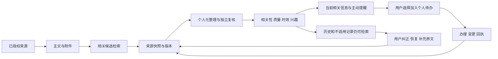

# 主动链路与 Harness 技术说明

最新的演示账号、完整办理投影、扫描PDF分页证据、聊天收件与流结束修复，以及真实模型成功和性能反例，见 [演示账号与底层链路续审](DEMO_CONTINUATION_2026-11-02.md)。下文逐批数字、每日额度及模型组合保留当时状态；当前配置和最新冻结验证以续审及带生成时间的证据为准。

最新的聊天回执/引用/反馈协议、内容优先与专用UI编排入口，以及真实模型首屏和最终复核耗时，见 [深度交互与内容优先改造](DEEP_INTERACTION_2026-11-02.md)。本次继续复用既有主链路；正式试点状态不能由本地测试或示例界面推定。

本地核查日期：2026-11-02。本次用户确认的是 Harness（运行控制与验证），不是 Hermes。需求与交付边界见 [验收账本](ACCEPTANCE.md)，上游核查数据见 [公开仓库版本和 CI](upstream-review-2026-11-02.json)。当前最终审计状态见 [全量审计与修复账本](FULL_AUDIT_2026-11-02.md)；本文此前逐批验证的数字保留为历史，不能替代该账本的最终代码测试与真实运行结果。

## 单一主链路

系统持续追踪信息，不要求用户逐条选择是否跟踪；加入待办由用户决定。自动整理、个人办理、原文更新和推荐纠正分别保留记录，不增加新的工作台。

## 阶段控制与恢复

| 阶段和入口 | 核对与持久状态 | 界限及恢复 |
|---|---|---|
| `source_sync.poll/poll_batch` | 授权栏目、来源版本、持久游标与租约；2 路来源并发，空位立即接下一源 | 每 30 秒检查到期来源，不等于每 30 秒抓全部网站。按订阅间隔轮询，错误持久退避，最多为基础间隔 8 倍 |
| `notice_intake.read_link/read_notice_materials` | 公网和逐次跳转校验、正文位置、获取时间、原件指纹、附件引用关系 | 显式同域 PDF/DOCX/XLSX/CSV/TXT/Markdown/PNG/JPG/JPEG/WebP 最多读取 4 份；需登录、格式不支持、超限或解析失败显示缺口，不冒充已读 |
| `notice_network.read_network/retain_unavailable` | 已授权栏目和原文链接中的同事项候选；附件、链接候选、栏目候选分开 | 最多 2 个关联候选，不把标题相似当替代效力。不同年份、届次、讲次排除。临时失败保留最近成功快照和原获取时间，不能使延期依据消失后退回旧要求 |
| `notice_ingest.ingest_notice` | 每用户来源回执、正文和附件历史、指纹、版本与修订 | 主通知不同但证据集合相同不误合并；新原文使旧草稿失效，已保存个人办理进度保留 |
| `notice_automation.queue_ready/run_once` | 总体同意、每日额度、来源仍获授权、输入版本、个人条件哈希 | 修订和新消息优先，用户间轮转，同类消息优先较新发布日期。初始历史也自动分析，但静默收录；失败和计费不确定不盲重试 |
| `ai.validate_extraction/notice_semantics` | 真正原文引用、日期时刻配对、独立复核 | 默认整理与复核，必要时补正并再复核，最多 4 次模型请求。未知对象、未读附件和未知年份不能自动变成资格或截止 |
| `notice_lifecycle.lifecycle/proactive_policy.assess` | 相关性、独立核对、时效、兴趣与静默词分别判断 | 已过有据期限退出新机会；未明确结束时间的旧讲座只称“已过原文活动日期”，不宣称已结束。24 小时内有据期限优先提示，仍遵守免打扰 |
| `/api/proactive/notices/{id}/feedback` | 账号范围、通知版本和纠正版本双校验，审计，可恢复自动判断 | 纠正推荐不伪造资格或改写原文；移出推荐不自动取消既有个人办理记录。个人待办由原有版本化操作管理 |
| `push_delivery` / `mail_delivery` | 共用候选、分级和摘要策略；发送前重算，保存实际接收引用 | 取消失效队列，已受理/邮件计费不确定不盲重发。供应商接收不等于用户已读；短信验证码不是通知短信 |

本轮补正：复核完整返回但结构/引用/覆盖校验失败时，允许共享四次预算内的一次格式恢复，重新使用全部校验并在调用前核对来源与个人条件；网络失败、超时和截断不自动重放。消耗格式恢复预算后仍有实际内容问题就保留问题，不叠加两次内容补正。当前主整理模型为 MiMo Pro、独立复核模型为 MiMo Flash，逐次实际模型与耗时记录在运行指标中。

## 聊天、知识与记忆

- 延续 MiMo Pro、思考模式、既有输入输出预算和独立复核。没有通过降档、关闭复核或缩短输出额度宣称提速。
- `grounding.select_sections` 返回长段落命中位置附近的连续原文；每个片段保留原段位置、绝对字符偏移和原长。不同查询的片段有不同字符定位，防止覆盖导致前一引用失效。`read_source` 可回到本人存储的完整原段分页读取。
- `ChatRun.local` 合并同轮、同查询、同授权范围的并发读取。本人记录/记忆改变时使缓存代际失效；旧在途结果不能重新写入新缓存。没有跨账号或跨版本的全局答案缓存。
- 记忆召回移到工作线程，避免 SQLite/全文检索阻塞事件循环。沿用本人/项目/专题、来源版本、撤回、删除和临时记忆边界；助手旧回答不能升级为学校事实。通知投递偏好不进入模型。
- 保留每轮实际检索次数、缓存命中与耗时，以及既有模型、工具、补正和复核指标。工具执行实际受业务授权和回执控制；每轮模型请求上限 24，重复无进展工具上限 3。
- 解析版本为 `notice-extraction-v2-date-ranges`。只有明确起始年份且连续相连的日期区间才承接省略的年/月；倒置且未明确跨年的区间继续待核实。不能从发布日期给独立的“12月15日”补年份。规范化只在解析器内部执行，保存引文不变。
- 旧版本且需复核的 AI 草稿可按额度排队重新核对。当前版本仍有问题，不在每次轮询中重复计费；手工草稿不会被这条升级规则覆盖。

## 同步与界面

当前页面保存纠正后，通知列表、首页和未发送的提醒候选立即重算。其他可见客户端每 15 秒检查账号范围内的只读版本摘要；重新聚焦或联网也检查，纯时间状态按分钟核对。正在编辑的表单不会被后台刷新覆盖，新原文版本提供读取入口。15 秒是客户端状态检查，不是官网采集或模型分析的总耗时承诺。

移动底栏为 4 个主要入口加“更多”，聊天直接在底栏。教师个人入口优先日程，学生/教职工优先待办；学院与系统维护入口依据实际授予的身份切换，自填身份不授予发布或管理权。桌面个人导航保留 5 个常用入口，其余展开查看。来源诊断和低频筛选在通知页展开，首屏先展示信息。

## 当前验证与不能据此宣称的内容

- 全量回归批次 1462 通过、1 跳过、1 个采集重构后的测试注入位置失败；已修正注入位置，相关 115 个补跑用例通过。179 个主动链路集成用例通过；末次日期、排队和原文边界修改另行补跑，以 `artifacts/proactive-final-temporal.xml` 的最终结果为准。这些批次重叠，不能相加声称独立用例总量。
- 真实 MiMo 合成样例：冲突 20.58 秒、日历/待办执行 29.62 秒、记忆保存 30.19 秒，均通过独立复核。它们不代表稳定 p95 或整体准确率。记录在 `artifacts/proactive-quality-*/results.json`。
- 本地 121 份、约 175 万字的合成检索，旧版本漏掉长段尾部关键句，新版本命中并保留精确原文。脚本 `scripts/verify_retrieval_quality.py` 比较当前 HEAD 基线与当前代码；结果为 `artifacts/proactive-retrieval-comparison.json`。这是本机微基准，不能换算为聊天同等幅度提速。
- 实际试用账号已启用 2 个官网来源，自动整理每天最多 2 则；该限制用于控制试用调用量，不代表能立即处理完全部历史。首次真实自动批次中 1 条通过复核，1 条保留需复核；真实原文暴露的连续日期区间解析问题已纳入修复和回归。
- 关联查找目前覆盖已授权栏目和正文链接，不是全网完整爬虫。公众号截图只是账号清单，任意公众号持续接收仍未接好。主文、附件和候选合计仍受 10000 字、5 MiB 等解析预算限制，超限显示缺口。
- 学校未提供接口，不能声称已自动完成校内正式提交或审核。需登录的官网内容不能冒充公开采集成功。真实移动后台到达、外网持续运行和至少 5 天试点仍需实际验收；本次没有购买服务器或域名。

## 本次选用的参考机制

上游元数据、稳定发布、许可证与实际 CI 已逐一核对：

- [changedetection.io](https://github.com/dgtlmoon/changedetection.io)：内容变化比较、过滤、轮询和恢复。
- [RSSHub](https://github.com/DIYgod/RSSHub)：订阅协议与缓存竞争控制；AGPL，未将其实现复制入本项目。
- [OpenAI Agents Python](https://github.com/openai/openai-agents-python)：有边界的工具循环、逐工具检查和可观测性；继续使用本项目 MiMo 接入。
- [LangGraph 1.2.19](https://github.com/langchain-ai/langgraph/releases/tag/1.2.19)：检查点与恢复语义。开发 HEAD 的 CI 失败，稳定版本对应 [CI 成功](https://github.com/langchain-ai/langgraph/actions/runs/41136797808)，二者没有混写。
- [Novu](https://github.com/novuhq/novu)：接收者偏好、固定摘要窗口和投递状态语义。存在不同许可证区域，不整体引入。

这些是机制适配，没有把多套完整框架叠加到现有运行时。WeRSS 只保留为实验候选，尚未证明满足本项目核心依赖门槛；已归档的公众号方案不采用。

末次补跑：日期/采集/排队相关 131 通过，生成/确认/补正相关 47 通过，推送/邮件/纠正策略相关 63 通过；前端 220 通过。来源更新已收紧为：已有本人事项继续提醒；本人明确恢复关注的信息可提示待核对更新；其他未选择信息只有当前版本通过分级后才安排，不能通过“新增关联材料”绕过个性化筛选。

前端实际检查：390×844 手机、834×1112 平板、1440×900 桌面未发现横向溢出；手机通知首卡约在 y=284。学生底栏为首页/通知/小信使/待办/更多，教师为首页/通知/小信使/日程/更多。使用独立 HTTP 客户端修改合成账号反馈，已打开页面未重载即同步；纠正保存与恢复后原文期限保持不变。屏幕截图与汇总在 `artifacts/proactive-ui/` 和 `artifacts/proactive-final-verification.json`。这是浏览器验证，不是 Android/iOS 系统后台通知验收。
