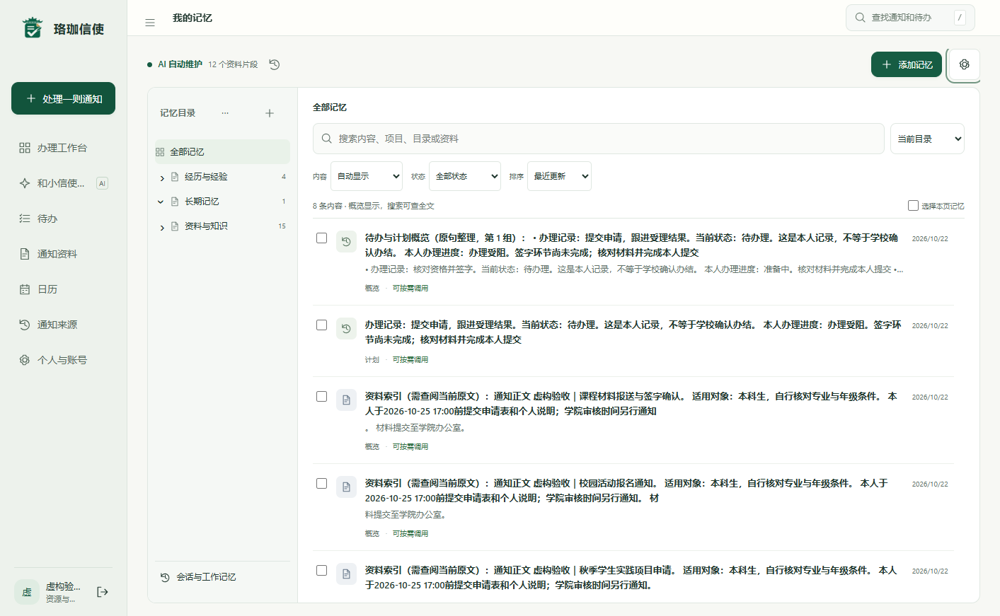
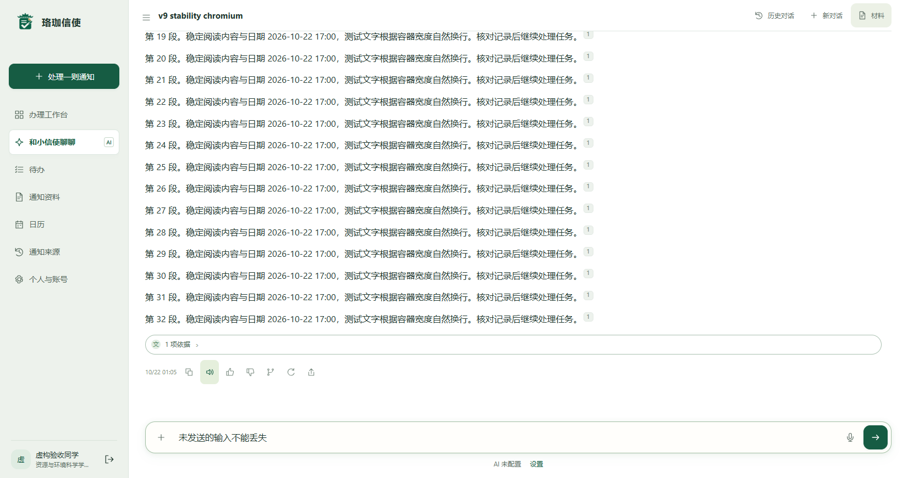

# 1.19.0 验证证据

这份结果包记录本地实际执行的测试，应用源码基线为 [`cec1dd9`](https://github.com/hxjyaohaohaode/luojiaxinshi/tree/cec1dd9bdfc86da8152d13ae3a82ea730691b820)。本次同时发布了便于复现的验证工具及 Actions 报告保存配置。下表不代表 GitHub 云端已经通过；云端状态和运行提交请查看 [GitHub Actions](https://github.com/hxjyaohaohaode/luojiaxinshi/actions/workflows/checks.yml)。

| 证据 | 结果 | 可查看内容 |
| --- | --- | --- |
| [浏览器稳定性](browser-stability.json) | 102 项通过 | 三种浏览器、九种窗口、侧栏宽度、记忆管理、原节点与原字号、草稿和音频复用 |
| [既有界面回归](browser-regression.json) | 198 项通过 | 原二十条浏览器反馈对应的布局和交互检查 |
| [相关后端回归](python-related.json) | 58 项通过 | 每项测试名称、结果与耗时；范围为语音、缓存、工作区、核心工作流 |
| [前端单元测试](node-unit.json) | 131 项通过 | 每项测试名称、结果与耗时 |
| [证据导出保护](verification-tools.json) | 2 项通过 | 拒绝非合成或失败快照；清除属性、捕获输出和额外字段 |
| [文件摘要与来源](manifest.json) | SHA-256 | 证据文件摘要、验证工具摘要与应用基线提交 |

后端 58 项对应 1.19.0 的相关回归范围。Actions 的 Python 作业执行完整 `tests/`，包含后来新增的验证工具检查；两者范围和数量不同。完整测试源码在 [tests](../../../tests)，浏览器入口为 [run_browser_checks.py](../../../scripts/run_browser_checks.py)。

结果包仅保留测试项、结果、耗时与合成界面截图。导出时移除了 JUnit 中的主机名、捕获输出、属性和环境信息；没有上传真实账号、密码、Cookie、API 凭证、用户数据库、真实对话、私人截图或备份。原始含运行环境的材料继续留在本机。

复现时，在已经激活的 Python 虚拟环境中、从仓库根目录执行：

```sh
python -m pip install -r requirements-dev.txt
npm ci --ignore-scripts
npx playwright install --with-deps chromium firefox webkit
python -m pytest -q --junitxml=artifacts/ci/python-tests.xml
node --test --test-reporter=junit --test-reporter-destination=artifacts/ci/node-tests.xml tests/*.test.mjs
python scripts/run_browser_checks.py
python scripts/write_ci_summary.py
```

浏览器入口自动启动并清理 `127.0.0.1:8786` 合成服务，数据限于 `artifacts/ci-browser/data`，不会复用或停止已有服务。真实体验服务使用的 8765 端口不参与这些测试。浏览器脚本默认加载仓库锁定的 Playwright，无需配置个人电脑路径。

每次 Actions 运行会在 Summary 显示实际数量，在 Artifacts 保存 JUnit、逐项 JSON 和合成截图，保留十四天。报告没有生成时会明确显示缺失，不记作通过。

下面两张截图来自合成账号和合成数据：




