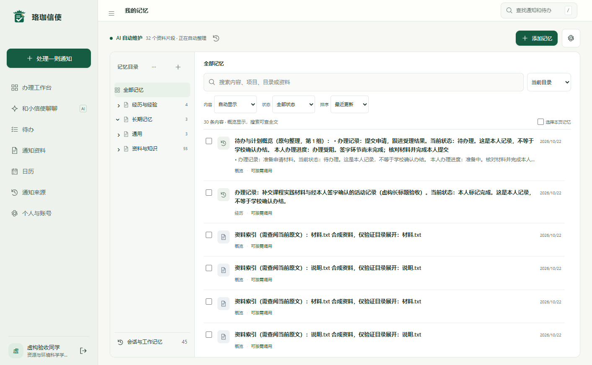
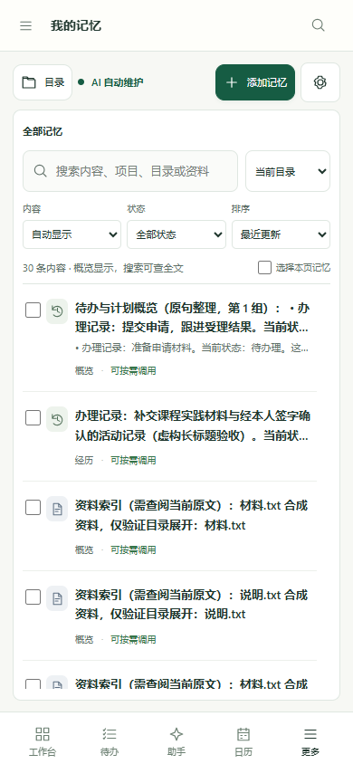
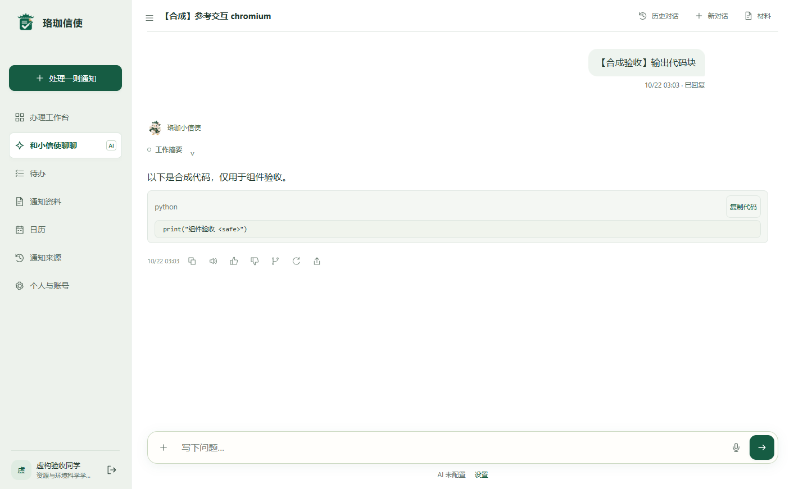
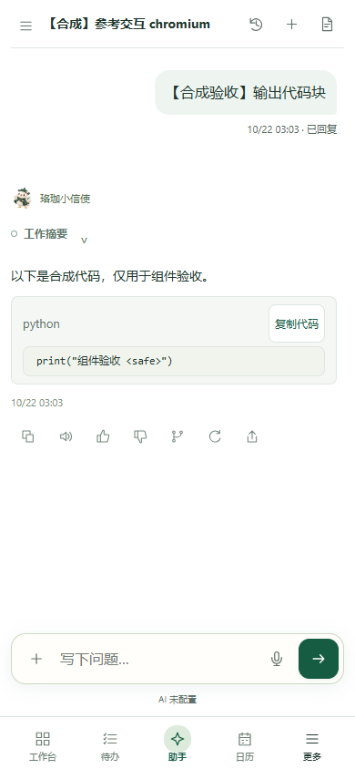

# 参考交互适配：验证证据

对应产品提交：[`8b90316`](https://github.com/hxjyaohaohaode/luojiaxinshi/commit/8b903162fe1bcfb879a0b29c0b91b4ee69d463d3)。验证使用 `bf03a7a` 的独立副本，加上本次提交的 13 个文件；逐文件核对与该提交一致。

这些是 **本地合成数据验收结果**，不是 GitHub Actions 状态。云端结果应查看对应提交的 [项目检查](https://github.com/hxjyaohaohaode/luojiaxinshi/actions/workflows/checks.yml)。未使用真实账号、正式数据库或真实模型调用。

| 范围 | 通过 / 总数 | 证据 |
| --- | ---: | --- |
| 原有界面稳定性，Chromium / Firefox / WebKit | 120 / 120 | [browser-stability.json](browser-stability.json) |
| 原有功能回归，Chromium / Firefox / WebKit | 198 / 198 | [browser-regression.json](browser-regression.json) |
| 本次参考交互，Chromium / Firefox / WebKit | 45 / 45 | [browser-interactions.json](browser-interactions.json) |
| Node 单元检查 | 132 / 132 | [node-unit.json](node-unit.json) |
| 验证工具及合成数据库边界 | 3 / 3 | [verification-tools.json](verification-tools.json) |

三组浏览器检查均在最终候选代码上重新执行，浏览器未记录未处理的页面错误。本地 Python 仅重跑上述 3 项验证工具检查；此处不把它说成后端全量验收。

## 核对内容

- 记忆区在 1413、1024、390、320 像素宽度下沿用原来的容器填充规则；原有 25 个 CSS 文件与 `bf03a7a` 完全一致（归一化换行）。
- 列表方向键定位、Enter 打开、原生 Tab 行为、列表内滚动及打开记录后的焦点。
- 通知表单校验、来回切换保留输入、完成标记、窗口变化中断过渡、减少动画偏好。
- 筛选区快速反向点击和真实筛选；上传多层文件路径后操作实际材料目录。
- 代码组件只有一个复制入口；等待时禁止重复提交，成功/失败有反馈，反馈恢复后可重试，代码正文保持完整。

[source mapping](../../REFERENCE_INTERACTIONS.md) 列出实际读取的参考文件、行号和适配落点。[manifest.json](manifest.json) 提供本次源码、原有样式和证据文件的 SHA-256。静态检查与几何检查不能代替使用者的视觉评价。

## 合成页面截图

### 记忆工作区





### 原有代码组件及复制入口





## 复验

安装项目开发依赖和 Playwright 浏览器后执行：

```sh
python scripts/run_browser_checks.py
```

验证脚本在 `8786` 建立独立合成服务；运行前若该端口已被使用则停止。每组检查之间仅清理该合成数据库内的登录限额，不改正式服务的限额规则。GitHub 工作流会保存三组报告、合成截图和测试日志，保留 14 天。
