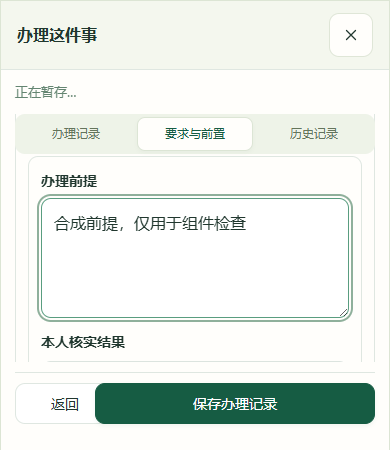
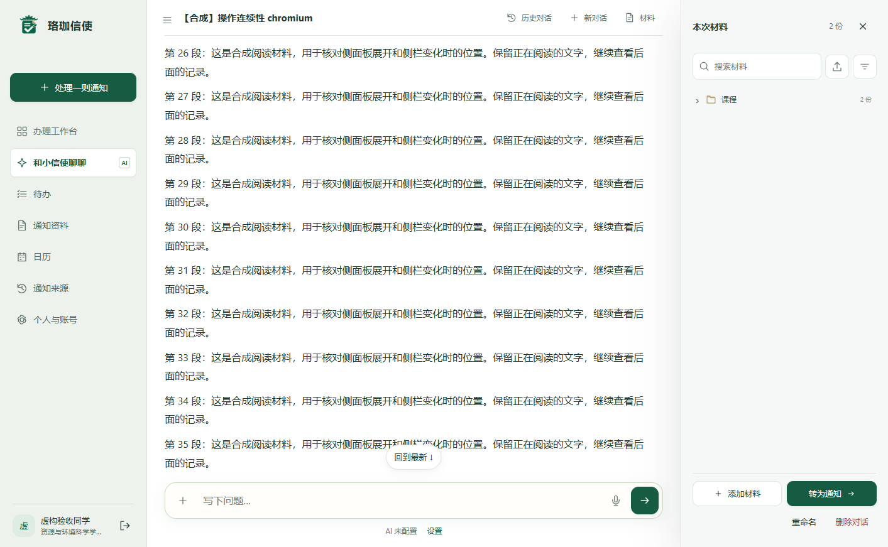
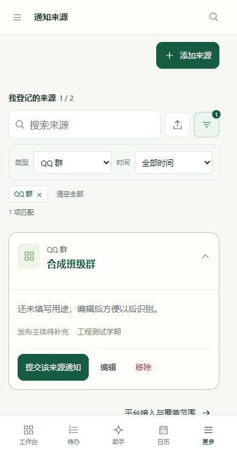

# 工作区操作连续性：验证证据

产品提交：[`b5995fc`](https://github.com/hxjyaohaohaode/luojiaxinshi/commit/b5995fca76adde8b9fdca6ea1a3c3692cd178c31)。独立验收副本基于 `4a51195`，仅加入本轮提交内容。发布前将副本中的应用、静态资源、脚本、测试、依赖和工作流逐文件与产品提交核对，文件摘要记录在 [manifest.json](manifest.json)。

以下为本地合成数据结果。真实账号、正式数据库、外部模型和真实语音服务没有参与。云端运行状态请查看 [项目检查](https://github.com/hxjyaohaohaode/luojiaxinshi/actions/workflows/checks.yml)。

| 检查范围 | 通过 / 总数 | 明细 |
| --- | ---: | --- |
| 原有布局稳定性，Chromium / Firefox / WebKit | 120 / 120 | [browser-stability.json](browser-stability.json) |
| 原有功能回归，Chromium / Firefox / WebKit | 198 / 198 | [browser-regression.json](browser-regression.json) |
| 原有参考交互，Chromium / Firefox / WebKit | 45 / 45 | [browser-reference.json](browser-reference.json) |
| 本轮工作区交互，Chromium / Firefox / WebKit | 54 / 54 | [browser-workspace.json](browser-workspace.json) |
| Node 单元检查 | 132 / 132 | [node-unit.json](node-unit.json) |
| 验证工具与合成数据边界 | 3 / 3 | [verification-tools.json](verification-tools.json) |

四组浏览器检查共 417 项，没有未处理的页面错误。数量用于说明已检查范围，不代替视觉评价或真实模型质量验收。

## 本轮核对的实际路径

- 清空关键词保留类型与时间；条件可单独移除，焦点跟随到相邻条件；键盘选择检索文件，删除文件条件保留关键词。
- 搜索失败保留最后结果与输入，重试有效；较早请求的响应不能覆盖新关键词，检索不会残留忙碌状态。
- 来源卡片重新检索后保留展开状态；材料检索临时展开匹配目录，清除搜索后恢复用户原有折叠选择。
- 全局搜索直接打开选中待办；分页保留输入和各自滚动位置；多个分页校验失败时，第一个出错字段可见并取得焦点。
- 390 像素宽、450 像素高窗口内可以滚动到编辑字段、完成实际保存；操作区和保存按钮可达。
- 通知菜单与聊天添加菜单支持方向键、Home/End、Escape；关闭菜单回到触发按钮，聊天未发送文字保留。
- 侧栏收起、恢复及材料栏展开时，原有正文节点、字号和正在阅读的文字位置保持；减少动画偏好下控件立即可用。

参考原文、行号和代码落点见 [交互适配记录](../../REFERENCE_INTERACTIONS.md)。现有字体、色彩、主工作区宽度和填充规则保留；CSS 增补仅用于筛选条件、任务按钮和小高度表单滚动。

## 合成页面截图

小高度编辑区：事项信息可以随内容滚走，分页和保存操作仍可访问。



材料栏展开后，现有聊天区按实际剩余宽度换行。



手机来源筛选，已选条件可以直接移除。



## 复验

安装开发依赖和 Playwright 浏览器后执行：

```sh
python scripts/run_browser_checks.py
```

脚本只使用 `8786` 上自己创建的合成服务，运行结束停止该服务。新增表单检查创建自己的合成事项，避免修改原有完成状态测试的前置记录。GitHub Actions 保留四组报告、截图与日志 14 天；本目录保存可直接浏览的脱敏快照。
